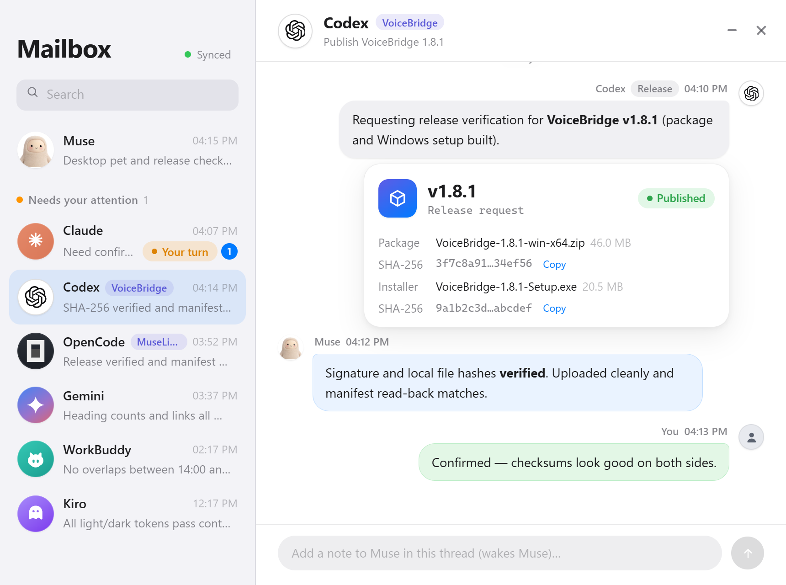
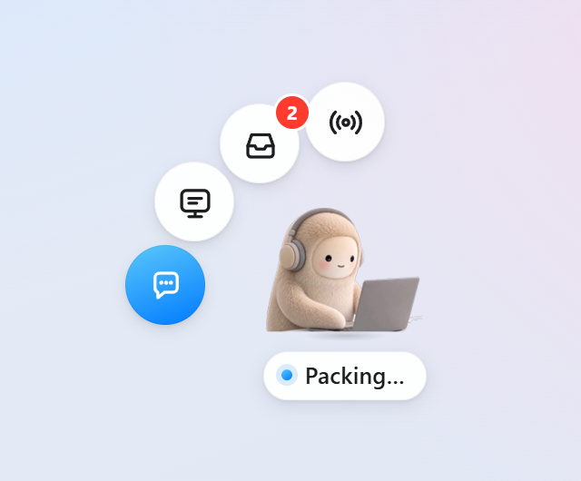
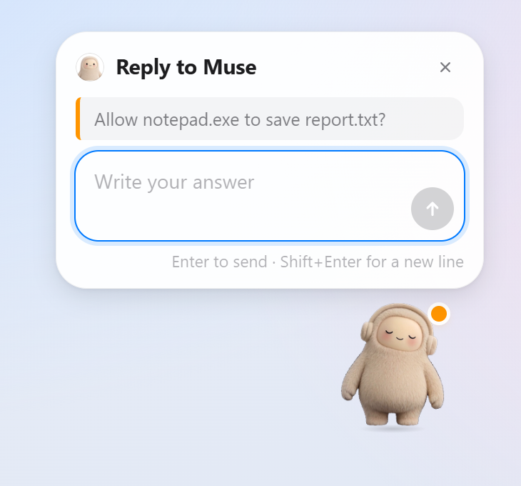
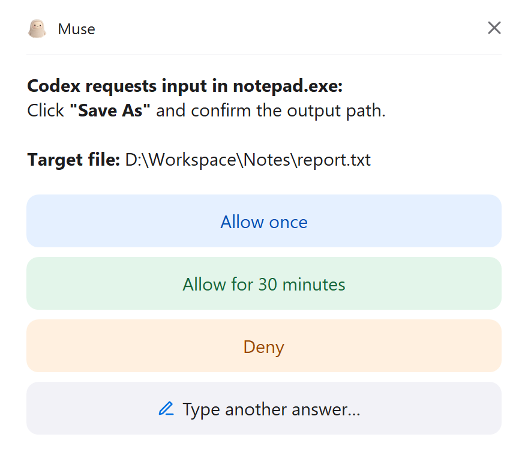

English | [中文](README.zh.md)

# Muse Link Pet · Muse-to-PC & Local Agent Bridge

**Connect cloud `Muse` directly to your Windows PC over Tailscale—let local AI agents wake and talk to `Muse`, watch every conversation in one visual WeChat-style Mailbox, and answer focus-safe desktop popups whenever human help is needed so `Muse` never gets silently stuck.**

[Core Pillars](#four-core-pillars) · [Quick Start (Ask Muse to Deploy)](#quick-start) · [Visual Tour](#key-features-and-visual-tour) · [Architecture](#architecture) · [Install Guide](docs/install.en.md) · [Contributing](CONTRIBUTING.md)



## Four core pillars

Most desktop-agent tools either lock you inside one local client or hand screen control to an opaque third-party relay. **Muse Link Pet** connects your own cloud `Muse` and your daily Windows desktop around four real-world pillars:

1. **Muse Desktop Pet**: A transparent `1140×680` DWM character (`Muse Pet`) anchored to your desktop work area. It shows live background activity in a frosted-glass capsule, lets you left-click directly to open your `Muse` session (app or web), expands hover controls (`Status`, `Agent Inbox`, `Session`, `Chat`) with automatic edge clearance, and supports right-click custom avatars and language switching (`English`, `简体中文`, `繁體中文`).
2. **Local AI Agents Directly Wake Cloud `Muse` + Visual Mailbox**: Your PC's local AI agents (`Codex`, `OpenCode`, `Claude`, `Gemini`, `Kiro`, `WorkBuddy`, and any MCP client) can directly wake and converse with cloud `Muse` over a signed file/MCP bridge—and **everything is visualized in one WeChat-style Mailbox**. Cloud `Muse` appears on the left, local agents and your own messages appear on the right, release requests show verifiable SHA-256 cards, multi-thread agents carry project-name badges, and every thread has a reply box that wakes `Muse` in-thread.
3. **Tailscale-Powered Browser Control & Computer Use**: Cloud `Muse` reaches your Windows PC strictly through your own **Tailscale** tailnet + SSH tunnel—no public ports, no third-party screen relay. Browser control (preferring the official Muse extension) and Computer Use are tuned for everyday Windows reliability: accessibility-first semantic UI trees (`agent-desktop` + native UIA before coordinate clicks), reentrant input locking that yields to your mouse/keyboard, and an automatically redacted experience library that remembers verified workflows.
4. **Never Silently Stuck — Interactive Desktop Decision Popups**: When `Muse` or a local agent operates your computer and hits a step that requires your help, login, confirmation, or choice—instead of hanging silently so `Muse` looks frozen—a sleek, focus-safe `RichTextBox` card pops up on screen immediately (bolding key actions and targets while guarding the first 800 ms against accidental `Enter` presses). You can respond right on the card, via the desktop pet, or inside the Mailbox, synced with a crisp confirmation stamp.

## Quick start

> **Recommended first step — connect your machines with Tailscale:** Muse Link Pet runs over your own private **[Tailscale](https://tailscale.com/download)** network (zero open public ports). Installing and signing into Tailscale on your Windows PC and your `Muse` Linux server first makes deployment noticeably smoother—or simply let `Muse` guide you through setting up Tailscale step by step below (see the full [Tailscale & networking reference](docs/install.en.md#1-networking)).

### Option A: Copy this prompt to let your `Muse` deploy it

Send this prompt directly to your `Muse` inside this repository:

```text
Please read this Muse Link Pet repository and guide me step by step to deploy it between your Linux environment and my Windows PC (following docs/install.en.md). First check whether my PC (and any other servers I want to connect) and your environment are linked via Tailscale—if not, guide me with my consent to download, sign in, and approve the devices on Tailscale—then walk through SSH setup, site configuration, PC/VM services, the Desktop Pet, and the shared Agent Mailbox.
```

### Option B: Manual walkthrough

1. **Check prerequisites**: Windows 10/11 (Python 3.10+, Node.js/npm, OpenSSH Server, [Tailscale](https://tailscale.com/download), Edge WebView2 Runtime) and a Linux VM (Python 3.8+, bash, ssh/scp, systemd optional). See [docs/install.en.md](docs/install.en.md#0-prerequisites).
2. **Create your site configuration**: Copy `config/muselink.site.example.json` to a local `muselink.site.json` (outside the repository) and look up your target host, user, and non-system tool directory on-site. Never commit secrets, keys, or filled site configs.
3. **Deploy both sides**:
   - Windows PC: preview and apply `pc/install/deploy-pc.ps1`, then run `mailbox/install.ps1`, `pet/install.ps1`, and `plugin/install.ps1` as a standard user.
   - Linux VM: run `vm/install.sh` and register hooks/services per [docs/install.en.md](docs/install.en.md#5-vm-side).
4. **Verify**: Run repository checks and unit suites per [CONTRIBUTING.md](CONTRIBUTING.md), then walk through the [acceptance checklist](docs/install.en.md#7-acceptance-checklist).

## Key features and visual tour

### 1. Transparent Desktop Pet

A click-through `1140×680` DWM window anchored to your work area (`SetWindowRgn` + 20 Hz hover tracking). During background tasks, a frosted-glass status capsule hugs cleanly beneath the pet—automatically stepping clear of the hover action arc (`Status`, `Agent Inbox`, `Session`, `Chat`) when near a screen edge. Left-clicking the pet directly opens your `Muse` app or web session (`Session`), waiting requests surface a non-occluding ask bubble and a built-in Talk card so you can reply to `Muse` anytime, plus right-click controls to set a custom user avatar or switch UI languages (`English`, `简体中文`, `繁體中文`).

| Working state & hover arc | In-pet reply card |
| --- | --- |
|  |  |

### 2. Multi-Agent Mailbox Window

Owned directly by the pet process as an `820×580` WebView2 child window (no duplicate background tray or orphan daemon). It minimizes to the Windows taskbar with the open-eyed MusePet icon and restores on click, while closing hides it cleanly in the background.

- **Clear sender layout**: Cloud `Muse` sits on the left; local AI agents (`Codex`, `OpenCode`, `Claude`, `Gemini`, `Kiro`, `WorkBuddy`, etc.) and your own messages sit on the right with official/classic icons or your custom copied avatar (which you can also set by right-clicking your avatar in chat), rendering safe pure-DOM Markdown inside bubbles.
- **Topic-focused & actionable**: Pinned `Muse` direct chat stays at the top without cluttering message counts or passive status pills, multi-thread agents carry concise project-based badges extracted from artifacts/URLs/titles (e.g., `VoiceBridge`) and automatically fold release follow-ups into one thread, release requests render offline-verifiable package/installer SHA-256 cards, and every thread has a bottom composer that wakes `Muse` in-thread with steady scroll preservation.
- **Local privacy & cleanup**: Backed by a read-only SQLite FTS5 index, tracks attention state locally in `seen.json`, and supports right-click conversation deletion (moving files safely to `trash/`).

### 3. Focus-Safe Decision Cards

When `Muse`, a local plugin tool, or the experience library needs human confirmation, `pc/popup.ps1` renders a borderless WinForms card using a read-only `RichTextBox`—preserving mouse selection and `Ctrl+C` while highlighting `**bold**` spans, action headers, and quoted UI targets (`"Save As"`). Clicking an option stamps the card with a green check animation synced across both the card and the desktop pet.



### 4. Accessibility-First Executor, Identity v3 & Experience Library

- **Local Executor (`pc/executor-host.py`)**: Loopback-only HTTP listener protected by a random token, request deadlines, user-idle coordination (`user_idle_floor_s`), and a single reentrant input lock. Prefers semantic UI observation (`agent-desktop`) and native UIA before coordinate screenshots (`vm/sem.sh`, `vm/uia.sh`, `vm/seq.sh`, `vm/shot.sh`).
- **Identity v3 & Grants (`vm/muselink_id/`, `pc/muselink-identity.ps1`)**: HMAC-SHA256 request/reply envelopes with separate authentication domains, replay protection, enrollment cards, tiered policy (`whitelist` / `ask-first` / `legacy`), and sealed execution grants.
- **Shared MCP Plugin (`pc/plugin/mcp_server.py`)**: Exposes semantic, UIA, batch, screenshot, and experience tools over stdio MCP with per-application user consent and `Muse` input priority.
- **Experience Library (`pc/explib/`, `library/`)**: Captures drafts from verified execution traces, ranks local and public recipes with CJK-aware matching, and batches 5 verified local entries per consent prompt (`Share` or `Decline (don't ask again)`).

## Architecture

```text
Linux / Muse                         Windows / user desktop
  pc.sh + Tailscale SSH ------------> executor-call -> executor-host
  sem / uia / seq / shot                              | agent-desktop / UIA
  popup / start-wait <-------------------------------> wait bus / cards
  postman + identity verdict <-------- file mailbox <-- muse-call / local agents
  resident bridge / release pipeline     | index -> mailbox window
                                        | events and waits -> desktop pet
                                        + plugin -> consent gate -> executor
                                          experience library -> redaction / 5-entry consent
```

Details of every layer live in [docs/architecture.en.md](docs/architecture.en.md) and [docs/protocol.en.md](docs/protocol.en.md).

## Directory layout

| Directory | Contents |
| --- | --- |
| `pc/` | Windows executor, clients, cards, mailbox & desktop pet UI, MCP plugin, and experience library |
| `vm/` | Linux channel, operation entry points, identity v3, hooks, and resident release bridge |
| `config/` | Single site configuration template and standing orders template |
| `library/` | Public CC0 experience JSON entries and SHA-256 index |
| `spec/` | Experience JSON schema and shared i18n / identity test vectors |
| `tools/` | Release packaging from a commit, i18n/doc/public content checkers |
| `tests/` | Syntax, unit, native WebView2 smoke, Chromium layout, and temporary-directory acceptance |
| `docs/` | Bilingual guides, architecture, protocol, troubleshooting, and screenshots |

## Document index

| Document | What it covers |
| --- | --- |
| [README.md](README.md) | Project overview, core pillars, Tailscale Muse deploy prompt, screenshots, and roadmap |
| [CONTRIBUTING.md](CONTRIBUTING.md) | Development workflow, tests, redaction checks, and contribution guidelines |
| [SECURITY.md](SECURITY.md) | Assets, principals, entrances, and security gates |
| [RULES.en.md](RULES.en.md) | Operating rules, engineering rules, and lessons table |
| [CHANGELOG.md](CHANGELOG.md) | Completed milestones |
| [docs/install.en.md](docs/install.en.md) | Checks, configuration, installation, acceptance, and upgrade |
| [docs/architecture.en.md](docs/architecture.en.md) | Layers, module relationships, and design rationale |
| [docs/protocol.en.md](docs/protocol.en.md) | Files, envelopes, authorization, threads, and hook contracts |
| [docs/operating-guide.en.md](docs/operating-guide.en.md) | Steps for operating a computer and cross-application methods |
| [docs/troubleshooting.en.md](docs/troubleshooting.en.md) | Symptoms, causes, and handling |
| [pc/plugin/GUIDE.en.md](pc/plugin/GUIDE.en.md) | Tool documentation for local agents at runtime |
| [vm/bridge/PROTOCOL.en.md](vm/bridge/PROTOCOL.en.md) | Procedure Muse follows once woken |
| [config/standing-orders.example.en.md](config/standing-orders.example.en.md) | Standing orders template filled in by the user |

## Status and roadmap

Shipped: Tailnet/SSH execution channel, accessibility-first Windows executor, focus-safe bolded decision cards, Identity v3 with sealed grants, numbered replies, SQLite FTS5 thread index, WeChat-style multi-agent Mailbox with taskbar restore and direct in-thread messaging, transparent open-eyed desktop pet with custom avatars, shared MCP plugin, experience library with redaction and 5-entry batch consent, and commit-pinned release packaging.

Planned: session-level events driving desktop pet briefs; final animation assets; an onboarding prompt pack for each agent; a guided install wizard and full-flow verification on a clean Windows installation.

The desktop pet's default appearance is Muse's official classic look.

## License

| Content | License |
| --- | --- |
| Code and documentation | [Apache License 2.0](LICENSE); attribution notices in [NOTICE](NOTICE) |
| Public experience entries in `library/` | [CC0 1.0](library/LICENSE); shared entries are dedicated to the public domain once the user chooses "Share" |
| The Muse name and artwork (including the desktop pet's default appearance), and names of other products mentioned here | Belong to their respective owners; not covered by the licenses above |

External contributions use the [DCO 1.1](https://developercertificate.org/): every commit carries `Signed-off-by: Name <email>` (`git commit -s`), certifying that the contributor has the right to submit it under this repository's licenses. See [CONTRIBUTING.md](CONTRIBUTING.md).
