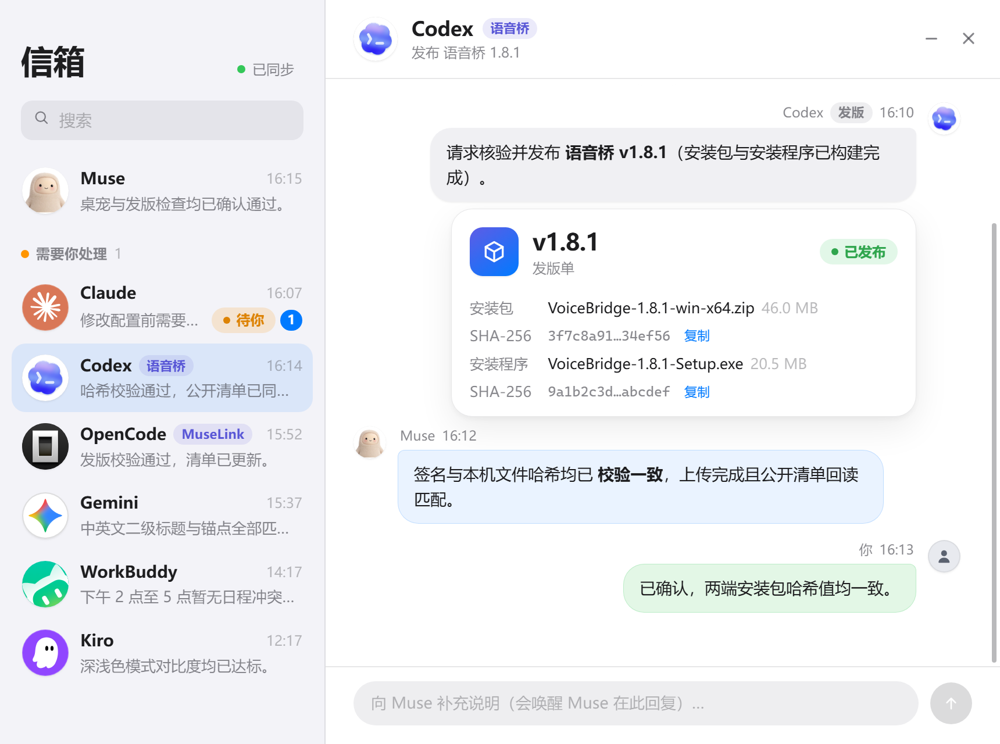
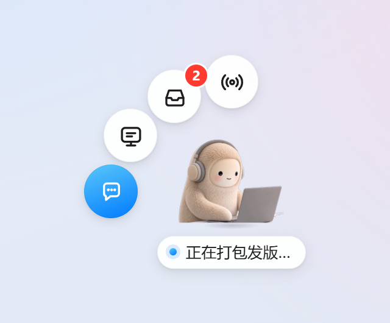
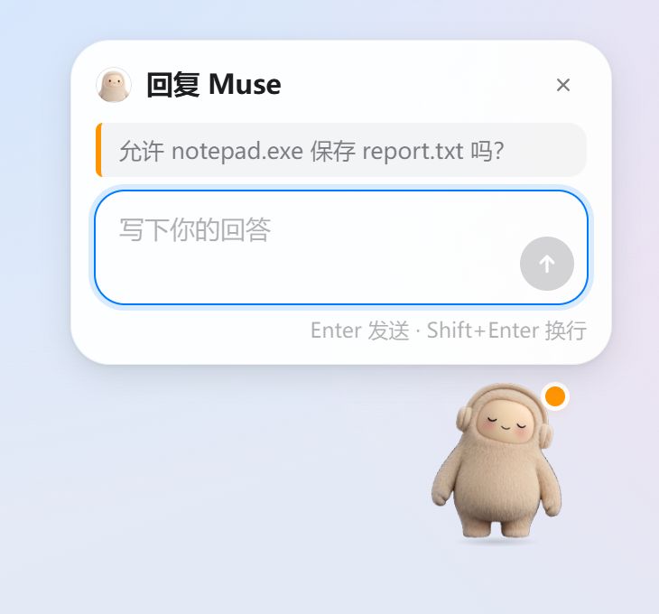
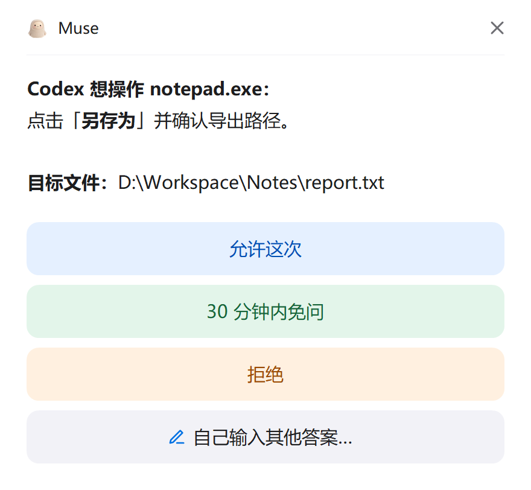

[English](README.md) | 中文

# Muse Link Pet · 云端 Muse 连电脑与本地 Agent 直通桥

**通过 Tailscale 把云端 `Muse` 直接连上你的 Windows 电脑——电脑本地 AI 代理可直接唤醒并与 `Muse` 对话，全部交流收拢在一个可视化类微信信箱里；当操控电脑遇到需要人类帮忙或拿主意时，直接在屏幕弹出防抢焦点交互卡，再也不用干等或误以为 `Muse` 卡住。**

[四大核心能力](#四大核心能力) · [快速开始（一句话让 Muse 部署）](#快速开始) · [实景演示](#核心功能与实景演示) · [架构总览](#架构总览) · [安装手册](docs/install.zh.md) · [参与贡献](CONTRIBUTING.zh.md)



## 四大核心能力

大多数桌面代理工具要么把能力锁在单一本地客户端里，要么得把屏幕和控制权交给第三方云端中继。**Muse Link Pet** 围绕真实日常使用，打造了四条核心能力：

1. **缪斯桌宠（Muse Desktop Pet）**：一个常驻桌面、透明点击穿透的 `1140×680` DWM 桌面宠物。后台干活时紧贴脚下显示磨砂进度胶囊，左键点击直接打开你的 `Muse` 应用或网页会话，悬停展开功能圆钮（状态、Agent 信箱、会话、聊天）并自动避让屏幕边缘，右键支持更换本地头像与即时切换中英文界面。
2. **电脑本地 Agent 直接唤醒云端 `Muse` + 可视化桌面信箱**：你电脑里的各类 AI 代理（`Codex`、`OpenCode`、`Claude`、`Gemini`、`Kiro`、`WorkBuddy` 等）不再各自孤立干活——它们可以通过带签名与回执的文件/MCP 桥**直接唤醒云端 `Muse` 对话协作**，而且**所有往来都在一个可视化类微信信箱中一览无余**：云端 `Muse` 在左，本机各代理与你在右，自动按项目归并话题徽标、渲染 Markdown 与发版 SHA-256 卡片，你也能随时在任意对话底部发消息唤醒 `Muse`。
3. **经 Tailscale 实现安全优化的浏览器控制与 Computer Use**：云端 `Muse` 仅通过你自己的 **Tailscale** 私有组网 + SSH 隧道直连日常登录的 Windows 桌面，不开放任何公网端口、不走第三方推流中继；围绕真实 Windows 使用习惯做了深度优化——优先走无障碍语义树（`agent-desktop`）与原生 UIA，配合可让行用户键鼠的输入锁、浏览器扩展协同及自动脱敏的经验库，越用越稳、越用越快。
4. **遇事不卡死——防抢焦点的桌面交互弹窗**：当 `Muse` 或本机代理在操控电脑过程中遇到需要你登录、协助、拍板或确认的关键一步时，**不会默默卡在后台让你以为 `Muse` 失联了**，而是立刻在电脑屏幕弹出优雅的防抢焦点交互卡（重点动作与目标自动加粗、前 800 ms 屏蔽误触回车），你可以直接在弹窗、桌宠气泡或信箱里回复，双方状态实时绿勾同步。

## 快速开始

> **部署前建议先连好 Tailscale：** 本项目通过 **[Tailscale](https://tailscale.com/download)** 把你的 Windows 电脑与云端 `Muse` 所在的 Linux 服务器安全连入同一私有网络（零公网暴露）。你可以先在两台设备上下载并登录 Tailscale，部署体验会更顺畅；也可以直接把下面这段提示词发给你的 `Muse`，让它对照 [Tailscale 组网配置参考](docs/install.zh.md#1-组网) 从头引导你安装、连网（甚至按需接入更多服务器）并完成全部部署。

### 方式一：直接复制这段提示词发给你的 `Muse`

把下面这段话直接发给你的 `Muse`（附带本仓库地址或目录即可）：

```text
请读取本 Muse Link Pet 仓库，严格按 docs/install.zh.md 一步步引导我完成部署：先检查并用 Tailscale 把你的 Linux 环境与我的 Windows 电脑（以及我想接入的其他服务器设备）连入同一个网络——如果还没有安装或登录 Tailscale，请先征得我同意后引导我下载、登录并批准设备；随后再依次引导我完成 SSH 密钥信任、站点配置、PC/VM 服务、缪斯桌宠与可视化 Agent 信箱的部署和验收。
```

### 方式二：手动分步部署

1. **核对前提条件**：Windows 10/11（Python 3.10+、Node.js/npm、OpenSSH Server、[Tailscale](https://tailscale.com/download)、Edge WebView2 Runtime）与 Linux VM（Python 3.8+、bash、ssh/scp、可选 systemd），见 [docs/install.zh.md](docs/install.zh.md#0-前置条件)。
2. **准备站点配置**：从 `config/muselink.site.example.json` 复制一份 `muselink.site.json` 到仓库外本机目录，并在目标机现场核对填写地址、账户和非系统盘工具目录。绝不向仓库提交任何密钥、令牌或已填配置文件。
3. **部署两端**：
   - Windows PC：以普通权限预览并执行 `pc/install/deploy-pc.ps1`，随后依次运行 `mailbox/install.ps1`、`pet/install.ps1`、`plugin/install.ps1`。
   - Linux VM：运行 `vm/install.sh` 并按 [docs/install.zh.md](docs/install.zh.md#5-vm-侧) 注册钩子与服务。
4. **验收自检**：按 [CONTRIBUTING.zh.md](CONTRIBUTING.zh.md) 运行仓库检查脚本与各模块测试，并对照 [验收清单](docs/install.zh.md#7-验收清单) 逐项核对。

## 核心功能与实景演示

### 1. 透明桌面宠物（Desktop Pet）

一个常驻桌面的 `1140×680` 透明点击穿透 DWM 窗口（基于 `SetWindowRgn` 与 20 Hz 指针离开兜底检测）。后台干活时，苹果/鸿蒙风格的磨砂胶囊紧贴角色正下方显示实时进展，靠边或悬停展开功能圆钮（状态、Agent 信箱、会话、聊天）时自动避让且零遮挡；左键点击桌宠直接打开 `Muse` 应用或网页会话，`Muse` 等待确认时弹出提示气泡和快捷回复面板，右键菜单支持隐藏、退出、设置本地头像（自动裁切拷入应用目录）及切换界面语言（`English`、`简体中文`、`繁體中文`）。

| 工作胶囊与悬停圆钮 | 桌宠快捷回复卡片 |
| --- | --- |
|  |  |

### 2. 多代理信箱窗口（Mailbox Window）

由桌宠进程直接持有的 `820×580` WebView2 子窗口（不额外拉起重复后台托盘或常驻守护）。点最小化时缩入 Windows 任务栏显示白底睁眼 MusePet 图标，点击任务栏即可重新打开；点关闭则温和隐藏到后台随时待命。

- **清晰阵营布局**：云端 `Muse`（白底睁眼宠物头像）固定在左侧，本机各 AI 代理（`Codex`、`OpenCode`、`Claude`、`Gemini`、`WorkBuddy`、`Kiro` 等均采用各自官方经典应用图标）和你的发言统一在右侧，支持右键头像直接设置本地头像与纯 DOM 安全 Markdown 渲染。
- **核心主题直达**：默认置顶 `Muse`（`pet/chat`）对话且去除「几条」计数、「已完结 / 进行中 / 中间回信」等协议噪声，多会话自动从发版产物/链接/正文提取项目名称作为徽标（如「语音桥」）并合并同次发版跟进，发版请求直接渲染带安装包体积与一键复制 SHA-256 的发版卡片，打开会话直达底部且后台同步不乱跳滚，任意对话底部均可直接发消息唤醒 `Muse` 在当前线程回复。
- **本地索引与隐私清理**：基于只读 SQLite FTS5 全文检索（支持中文 1–2 字 LIKE 与 3+ 字 trigram），在本地 `seen.json` 记录待办注意状态，右键即可将不需要的对话安全移入 `trash/`。

### 3. 防抢焦点的重点加粗弹窗（Decision Cards）

当 `Muse`、本机插件或经验库需要你拍板时，`pc/popup.ps1` 弹出无边框卡片。正文区采用只读 `RichTextBox`，在保留鼠标框选与 `Ctrl+C` 复制的前提下，自动解析 `**...**` 并高亮前置动作说明、字段标签与引号目标（如「**另存为**」）；作答后播放绿勾盖章动效并与桌宠端双向同步。



### 4. 无障碍优先执行器、身份 v3 与经验库

- **本机执行器（`pc/executor-host.py`）**：仅监听回环地址，带随机令牌、请求截止时间、用户空闲等待（`user_idle_floor_s`）与全局可重入输入锁；优先走语义树（`agent-desktop`）和原生 UIA，最后才使用坐标截图（`vm/sem.sh`、`vm/uia.sh`、`vm/seq.sh`、`vm/shot.sh`）。
- **身份 v3 与授权（`vm/muselink_id/`、`pc/muselink-identity.ps1`）**：请求与回信用 HMAC-SHA256 验证，分别使用独立的认证域，带重放保护、代理登记卡、分级策略（`whitelist` / `ask-first` / `legacy`）与封印执行凭据。
- **共享 MCP 插件（`pc/plugin/mcp_server.py`）**：通过 stdio MCP 为本机代理提供语义操作、UIA、批次执行、截图与经验工具，带逐应用同意闸与 `Muse` 输入优先让行。
- **经验库（`pc/explib/`、`library/`）**：从已验证执行轨迹自动起草方法，按本机/公共库及中文 bigram 相关性检索，并在累计满 5 条已确认条目时弹出一次脱敏批量分享确认（「分享」或「拒绝（不再询问）」）。

## 架构总览

```text
Linux / Muse                         Windows / 用户桌面
  pc.sh + Tailscale SSH ------------> executor-call -> executor-host
  sem / uia / seq / shot                              | agent-desktop / UIA
  popup / start-wait <-------------------------------> 等待总线 / 弹窗
  邮差 + 身份裁决 <------------------- 文件信箱 <------- muse-call / 本机代理
  常驻桥 / 发版流水线                    | 索引 -> 信箱窗口
                                        | 事件与等待 -> 桌宠
                                        + 插件 -> 同意闸 -> 执行器
                                          经验库 -> 脱敏 / 满 5 条询问分享
```

各层机制与契约详见 [docs/architecture.zh.md](docs/architecture.zh.md) 与 [docs/protocol.zh.md](docs/protocol.zh.md)。

## 目录

| 目录 | 内容 |
| --- | --- |
| `pc/` | Windows 执行器、客户端、弹窗、信箱与桌宠界面、MCP 插件与经验库 |
| `vm/` | Linux 通道、操作入口、身份 v3、钩子与常驻发版桥 |
| `config/` | 唯一站点配置模板、常设授权模板 |
| `library/` | 公共 CC0 经验 JSON 条目与带 SHA-256 哈希的索引 |
| `spec/` | 经验 JSON schema 与共享多语言/身份测试向量 |
| `tools/` | 从单一提交出包、i18n/文档/公开内容校验器 |
| `tests/` | 语法、单元、原生 WebView2 冒烟、Chromium 布局与临时目录验收 |
| `docs/` | 中英文安装、架构、协议、操作指南、排错手册与实景截图 |

## 文档索引

| 文档 | 负责的内容 |
| --- | --- |
| [README.zh.md](README.zh.md) | 项目总览、四大核心能力、Tailscale 与 Muse 一句话部署引导、实景截图 |
| [CONTRIBUTING.zh.md](CONTRIBUTING.zh.md) | 开发流程、仓库校验、脱敏规范与贡献指南 |
| [SECURITY.zh.md](SECURITY.zh.md) | 资产、主体、入口与安全闸门 |
| [RULES.zh.md](RULES.zh.md) | 操作规矩、工程规矩与教训表 |
| [CHANGELOG.zh.md](CHANGELOG.zh.md) | 已完成的里程碑 |
| [docs/install.zh.md](docs/install.zh.md) | 检查、配置、安装、验收和升级 |
| [docs/architecture.zh.md](docs/architecture.zh.md) | 分层、模块关系和设计依据 |
| [docs/protocol.zh.md](docs/protocol.zh.md) | 文件、信封、授权、线程和钩子契约 |
| [docs/operating-guide.zh.md](docs/operating-guide.zh.md) | 操作电脑的步骤与跨应用方法 |
| [docs/troubleshooting.zh.md](docs/troubleshooting.zh.md) | 按症状查原因与处理方法 |
| [pc/plugin/GUIDE.zh.md](pc/plugin/GUIDE.zh.md) | 运行时给本机代理的工具说明 |
| [vm/bridge/PROTOCOL.zh.md](vm/bridge/PROTOCOL.zh.md) | Muse 被唤醒后的处理规程 |
| [config/standing-orders.example.zh.md](config/standing-orders.example.zh.md) | 由用户填写的常设授权模板 |

## 现状与路线图

已完成：Tailscale/SSH 执行通道、无障碍优先的 Windows 执行器、支持重点加粗的防抢焦点决策弹窗、带封印凭据的 Identity v3 协议、编号回信、SQLite FTS5 线程索引、带任务栏还原与全会话直接发言的类微信多代理信箱窗口、带自定义头像与睁眼图标的透明桌宠、共享 MCP 插件、带脱敏与满 5 条批量询问的经验库，以及基于单一提交的换包工具。

计划中：会话级事件驱动桌宠简报；正式动画素材；各代理接入提示包；安装向导与干净 Windows 全流程验证。

桌宠默认形象是 Muse 官方的经典形象。

## 许可

| 内容 | 许可 |
| --- | --- |
| 代码与文档 | [Apache License 2.0](LICENSE)，归属说明见 [NOTICE](NOTICE) |
| 公共经验条目 `library/` | [CC0 1.0](library/LICENSE)；用户在分享卡点击“分享”后条目按 CC0 贡献至公共领域 |
| Muse 名称与形象（含桌宠默认形象）、文中提到的其他产品名称 | 归各自权利人，不在以上许可范围内 |

外部贡献使用 [DCO 1.1](https://developercertificate.org/)：每个提交带 `Signed-off-by: 姓名 <邮箱>`（`git commit -s`），表示提交者有权按本仓库的许可提交这些内容，详见 [CONTRIBUTING.zh.md](CONTRIBUTING.zh.md)。
