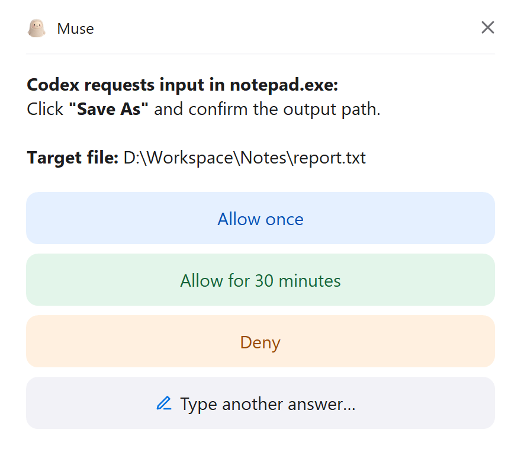
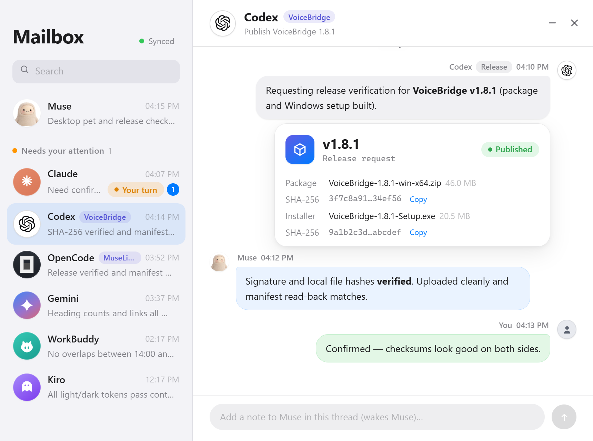
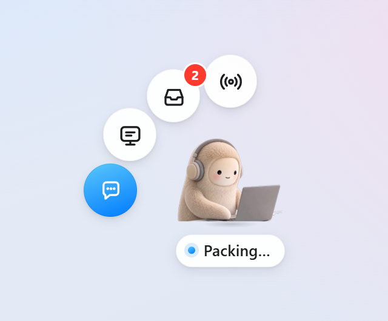

English | [中文](architecture.zh.md)

# Architecture

## 0 Overview and layers

The system consists of transport, execution, operation interfaces, waiting, the mailbox, interfaces, the plugin and the experience library. The Linux side organizes work and wakes Muse; the Windows side executes in the user's interactive session. Components share the tool directory and one site configuration, and keep recoverable state in files; background polling decides in the script whether Muse needs to be woken.

The overall code map is in README. Contract fields live in [protocol.en.md](protocol.en.md), deployment in [install.en.md](install.en.md), and operating conventions in [RULES.en.md](../RULES.en.md). This file explains why the modules are connected this way.

## 1 Channel

`vm/pc.sh` and `lib/muselink-common.sh` unify SSH parameters, the target account, the host fingerprint, file transfer and short waits; `pc-master.sh` provides ensure/check/down. `ts-connect.py` can attach to a CONNECT proxy in the runtime environment, and a direct tailnet connection also works. ControlMaster/ControlPersist reuse the connection, and it is rebuilt from the same configuration after it fails.

Measured on 2026-11-08: the persistent SSH approach gave P50 1114 ms and P95 1202 ms over 10 samples; the same master over HTTP port forwarding gave P50 2420 ms and P95 2611 ms, so SSH exec was chosen. Direct tailnet HTTP failed 10 times and Tailscale Serve failed 6 times, while the same proxy returned an SSH banner on port 22. The whole channel needs only SSH (port 22).

Earlier, opening SSH per command, triggering a task and polling for files took about 20–30 seconds per round. Input is now passed as JSON, a file or base64 parameters, so complex bodies are not carried by concatenating remote commands; long work runs in a process on the target machine and the channel only collects progress.

## 2 Executor

`pc/executor-host.py` is at version 4.2.0, runs in the logged-in user's desktop session and listens on loopback port 18744 by default; `executor-call.py` forwards a single line of JSON between the SSH session and the executor host and reads the local token. The host generates the token on first start; a named mutex and an exclusive bind establish a single instance, and a successful bind records host_start. The task registration target run level is Limited; the watchdog alone uses Highest.

The outer request returns transport results such as ok/ms/out, and the business status stays in the inner layer; `vm/lib/inner-status.py` keeps unknown. Input actions (native ad, sem, UIA and a whole seq) share one reentrant lock and the request deadline. Read operations run per handler. Before input, the host queries user idle time and by default waits for 2.5 seconds of idle, for at most 25 seconds; at the limit it continues and marks user_active. Synthetic input also resets that system timer, and user_wait_ms records the actual wait.

Shell is off by default, and script accepts only the configured allowlist. The host records structured events such as host_start/job_begin/job_end, rotated in the tool directory; logs do not replace evidence that an operation succeeded. On 2026-11-08 the early executor measured 1.13 seconds total for list-windows, with 104 ms in the host; a skeleton snapshot took 1.56 seconds total, with 670 ms in the host; one recovery after a failure, including an automatic restart and retry, took 8.6 seconds.

Related code: `executor-host-run.ps1`, `vm/executor.sh`, `pc/install/restart-host.ps1`, `fix-agent-desktop-owner.ps1`.

## 3 Operation layer

### agent-desktop and sem

agent-desktop provides the Windows accessibility tree and actions; this project wraps it and does not copy its adapters. The four verbs of `handle_sem` are observe/resolve/act/verify: observe offers skeleton/digest/full, and queries filter by name, role, surface and ancestor path; candidates are classified operable/decorative/no_ref. resolve separates resolved, ambiguous, not_operable and not_found. act disambiguates among operable candidates and keeps the upstream disposition, delivery and post_state; expect verifies the effect against the current state.

effect is verified or delivered_unverified; an unclear delivery such as a stale reference stays unknown and comes with a recheck. On 2026-11-08 a skeleton of one Electron application measured about 0.9 KB, and a digest about 7.6 KB for 89 elements, with one observe round taking 1.5–1.7 seconds; the small verdict keeps the whole tree on the host side.

An inventory of direct calls to agent-desktop 1.0.2 the same day, using the same Qoder window, produced these single samples, which led to the "filter locally, return small results" interface.

| Read method | Output bytes | Time |
| --- | --- | --- |
| Default snapshot | 25610 | 807 ms |
| skeleton | 2970 | 349 ms |
| skeleton with compact filtering | 2561 | 434 ms |
| Named subtree | 836 | 202 ms |
| find --count | 65 | 269–721 ms |
| find --first | 267 | 761 ms |
| get single property | 119 | 70 ms |

Two read-only batches from the same inventory totalled 324 ms, against about 1070 ms for separate calls; the upstream batch judges each result one by one and is not an atomic transaction. The host seq builds on this to combine semantics and UIA with conditional guards.

### UIA

Chromium can expose an editor as a Group that has SetFocus/TextPattern but does not fit agent-desktop's ref assignment rules. `pc/uia-helper.ps1` therefore adds locate/focus/invoke/read_text/focused; it relocates by semantic attributes on every call, and RuntimeId is only used to check the focused identity within one call. The target window scope is the union of all top-level windows of the process, matched by title when necessary; ambiguity, a missing Pattern and a non-focusable element each return a structured error.

The cross-application acceptance on 2026-11-08 covered a Win32 text editor, a Shell file list, a UWP settings page and a second Electron editor. A UWP window may be owned by a frame process, and its content tree is withdrawn while it is suspended in the background; a virtualized list materializes only visible elements. Combine operation methods according to what UIA exposes at the time, and keep application-specific solutions in the library rather than storing recipes in this file.

### seq and screenshots

`handle_seq` runs sem/UIA/sleep/act_if steps under one input lock in one round trip; unless skips the action when it is already satisfied; alternatives are tried against the final state and keep prior_attempts, and a first final failure reports stopped_at. On 2026-11-09 a seven-step check-in batch took about 7 seconds on the "skip if already claimed" branch.

`vm/shot.sh` calls the allowlisted script `pc/muse-shot.ps1` and returns image metadata and the file; the native PNG stays in the tool directory, a transferred image keeps its pixel dimensions, and the compression gate is in protocol section 8. A minimized window is restored with ad restore before the screenshot and minimized again afterwards. Coordinate actions are based on this run's file and the local DPI.

Entry points: `vm/sem.sh/uia.sh/seq.sh/shot.sh`; the host handlers are in `pc/executor-host.py`.

## 4 Cards and the wait bus

`popup-send.sh` handles direct transfer of the body file, the hash manifest, stage, markers, triggering and the short wait loop. `popup.ps1` shows info/choice/input cards in a borderless read-only `RichTextBox` (highlighting `**...**`, lead labels and quoted targets in bold while keeping selection and `Ctrl+C`), does not steal focus by default and has a keyboard guard window; the text closes on timeout and re-rings according to the reminder setting while the user has not touched it. `Complete-MuseWait.ps1` is the single completion entrance, and the ReqId plus a mutex guarantee first come, first served; the main wait uses a FileSystemWatcher for the completion event, and polling fallback handles a disconnected wait.

On 2026-11-03 the click reached the main-path wake in about 1 second; the platform fallback is scheduled every 60 seconds. `popup-fallback.sh` distinguishes still waiting, already consumed, recoverable, expired and PC unreachable, and does not treat a failed probe as an unanswered user. An owned card is collected again by the identity or plugin flow and is not taken in by the ordinary fallback.

`start-wait.sh` turns pid/file/cmd/web into the same wait protocol; on Windows, `Watch-LocalTask.ps1` watches the task and `web-bridge.ps1` receives web notifications; the watcher exits as soon as it loses ownership of the request. The web channel checks the loopback token, the origin, the ReqId and duplicate completion; the userscript is the page-side notifier. Body and status fields are separate, and the file details are defined only in protocol sections 6 and 7.



## 5 Mailbox and bridge

`muse-call.ps1` delivers atomically and keeps a copy in sent; the postman hook takes the earliest pending request, calls identity routing, moves the PC files according to the verdict and wakes Muse for the one request that needs it. A bad file does not block the queue behind it, and a release is taken over by the active resident service so the postman and the pipeline do not both run. Each postman round also calls the shared self-heal library to check the bridge service; the alert hook wakes independently for a new alert.

`vm/bridge/bridge-service.py` handles the release queue and recovers cards that await enrollment one at a time in a subprocess. `muse-bridge-reply.sh` keeps each reply in the ledger first, then sends it to the PC; the client reads the replies one by one, and the final reply ends the request. The numbering separates "received" from "completed", and delivery diagnosis cross-checks the ledger against the PC lifecycle.

The release pipeline checks the request and the path, measures the PC file version, size and hash, performs authorization, then arranges the PC upload, checks the remote files, publishes the manifest and reads back the public download. `pc/chunked-upload.ps1` skips completed chunks by the remote chunk size, its network subprocesses have deadlines, and the hash is verified after assembly. Earlier measurements on the same high-loss link gave 0.13 MB/s for one scp stream, 0.23 for 4, 0.71 for 12 and about 0.85 for 16 (96 MB in 112.5 seconds); 24 streams triggered the remote concurrency protection. The script therefore offers chunked parallelism, and the installer measures the concurrency and network capacity of the target side.

Code: `vm/hooks/bridge-postman.sh/selfheal-lib.sh/bridge-alert-watch.sh`, `vm/bridge/`, `pc/file-facts.ps1`, `pc/chunked-upload.ps1`. The handler role reads `vm/bridge/PROTOCOL.en.md`.

## 6 Identity and authorization

The identity layer sits between transport and business logic, checks the original envelope and outputs the work request and the verdict; the registry and grants carry seals, and replay and usage live in SQLite state. The origin of a request and the authorization to execute are separate: holding the key, being enrolled and being allowed to do something are three decisions. A deterministic execution point such as a release verifies the envelope again and matches the grant against the facts it measured itself; Muse handles a task according to the standing orders and the authorize result.

The only description of the details is in [protocol sections 3 and 4](protocol.en.md#3-identity-v3), and asset responsibility is in SECURITY. The modules are in `vm/muselink_id/`, and the signing entrances on the two sides are `pc/muselink-identity.ps1` and `vm/muselink-id.sh`.

## 7 Mailbox index and mailbox window

`pc/mlindex/` scans only the PC mailbox and merges copies and states per protocol section 5. SQLite WAL, a single-writer lock and read-only connections are kept apart; sync is equivalent to rebuild, and a file caught in motion is completed in the next round. FTS5 uses trigram, and queries shorter than three characters use LIKE; without FTS5, whole-database search uses LIKE. Attachments store only a path, size and hash reference and are not copied.

`pc/mailbox/` is an ordinary-privilege 820×580 pywebview/WebView2 child window owned by the pet process. Closing hides it; minimizing keeps it on the taskbar with the pet icon so clicking the taskbar button reopens it; reopening from the pet reuses it, with no separate tray or singleton. The legacy mailbox entrance forwards to the pet. Each window has a separate loopback static-only UI root; data crosses only the native js_api bridge. The shared syncer runs every 10 seconds while the pet runs, even when the mailbox is hidden; the UI polls every 5 seconds. A missing or incompatible index is rebuilt. Mailbox initialization, bridge and sync failures are isolated from the pet.

Alias merging, release follow-up consolidation (joining `<agent>/chat` release-check follow-ups into `<agent>/release`), and unfiled replies are rendered in the front-end model.js, while the index keeps the original identity and thread (`SCHEMA_VERSION = 2` parses up to 7-digit ISO fractional timestamps). Superseded `needs_user` items followed by newer messages in the same thread and declined `pending` enrollments are no longer surfaced as `waiting_user`. The interface keys follow `pc/mailbox/ui/fixtures/contract.json`, and the demo uses data of the same shape; the window renders Muse (with an open-eyed white-background pet avatar) on the left and both local AI agents (with white/classic icons) and user messages/replies (from the pet, mailbox composer, and popup logs—chronologically preserving Muse prompts ahead of user answers and formatting authorization prompts cleanly—using the user's custom copied avatar or neutral fallback, with right-click `Set avatar` on the user's own bubble avatar) on the right, renders safe pure-DOM Markdown (`markdown.js`) inside message bubbles, pins the direct `pet/chat` conversation with Muse at the top without cluttering section labels, provides a composer (`send_message`, waking cloud Muse in that thread) on every conversation, distinguishes multi-thread agents with concise project/topic badges derived from release artifacts, URLs, or cleaned subject text, hides passive protocol noise (message counts, `Done`/`In progress` header pills, and `Interim reply` bubble pills, keeping `Awaiting you` when user action is required), follows the user's language preference (`I18N.follow`), tracks per-item user-attention state in local state (`seen.json`), and supports right-click conversation deletion by moving that conversation's files to `trash/`. Routine non-actionable agent replies do not produce an unread badge count. The shared shell and the MIME table are in `pc/mailbox/shell.py`, so the Windows registry does not treat JS as plain text.



## 8 Desktop pet

`pc/pet/ui/layout.json` separates `ui_scale: 1` from `sprite_scale: 0.7`. UI coordinates, text, status marks, cards, panels and orbs stay at design size; only the character hit box, shadow and fitted sprite shrink about the existing bottom/center frame anchor. Hover growth and pop overshoot reserves use the real size of their respective character or UI element. The host and API read only UI scale and the 340×440 design window, giving 340×440 logical pixels before OS DPI scaling. The drag threshold stays at 4 screen pixels. The browser preview serves the same layout and renderer without a separate size override.

`pc/pet/` runs at ordinary privilege using the shared mailbox venv. Its transparent, topmost, nonactivating window is 1140×680 logical pixels: a 340×440 core with 400 pixels of left spill, 400 right and 240 below. Clicks outside the drawn native region pass through on every spill side. Only the measured visible sprite rectangle (`CHAR_RECT` in shared layout.json) is clamped to the monitor work area; the window may extend off any screen edge. Dragging more than 4 physical pixels moves the window. Version 2 of pet-position.json stores the visible sprite origin in physical pixels; legacy window origins migrate by subtracting the left spill at the current DPI. Startup, restore, drag release, display/DPI events and the 5-second fallback update placement and the logical window/work-area intersection (`avail`). The Session button (and left-clicking the pet character directly when no panel is open) tries, in order: the installed Muse web app (Chrome / Edge "install app", found as an app named Muse among the current user's uninstall entries in the registry, preferring the one in the `pet.session_profile` profile), opened as an app window; `pet.session_browser` (with `session_profile`) opening the session URL; the system default browser opening the session URL (`pet.session_url`, default https://muse.ai/). Right-click opens the hide/exit/set-avatar/language card (copying any chosen avatar image into the app directory so source removal never affects display); the pet tray restores it. Periodic anchoring preserves z-order.

There is no anchor reserve. Python pushes avail to JS, where one pure fit(rect, preferredSide, avail) places the talk/channel card, busy pill, ask bubble, menu and language flyout. The full-size talk card uses a +1 px sprite-top baseline (5 px higher than channel) with --talk-shift: -5%, and clamps both bottom and top. The busy pill centers below the character by default (with a 4 px gap) as a frosted glass capsule without a protruding tail; when the bottom edge or a downward arc blocks below, `busyRect()` picks the closest side or upper placement that overlaps neither the character nor any visible orb. The waiting-user ask bubble is placed by bubbleRect() around the character, alert indicator, and visible orbs so it never occludes them. The received checkmark celebration sits in `.pet-celebrate` (`z-index: 8`) above orbs, panels, and menus, and shadows stay compact near element contours. The action arc tries upper-left, upper-right, lower-left, lower-right, then translates the complete arc if needed. Talk keeps the exact same slot in hover and waiting_user, while Done sits directly beside Talk on its outer side with a 44px total reserve for pulse/hover/shadow (falling back only when work-area bounds force it). Pills sharing the arc side clear its controls vertically while keeping the horizontal body gap. Labels and flyouts clamp to avail; final size and entry spring are included in native regions, and hover tooltips enter the native region only while hovered/focused. Hover exit retracts promptly and is backed by 20 Hz pointer polling with region-sequence verification. Only the character remains at 70% scale, and ARC_DROP × 0.7 is preserved.

watch derives the state every 500 ms: waiting_user takes priority when pending and armed match; a recent job_begin/job_end shows working within the default 45-second afterglow, host_start clears the state, and otherwise it is idle. brief accepts only phase.text, collapses whitespace, strips control/format characters and retains at most 500 characters. The UI shortens it to eight graphemes including an ellipsis; expired/empty phases reveal a localized activity label derived from the latest job_begin, then animated dots. Interleaved job_end events preserve the latest activity. Source layouts are recognized by `pc/pet`, `vm` and `tools/check-public.py` rather than Git metadata and observe the stream beside app.py; flat installed packages observe their parent tool directory. `--events-dir` changes only the event stream, while singleton scope follows the source layout and popup bus. Startup logs the layout, stream and scope. Phase events are appended by the host's `kind=phase` request under the same write lock (Muse uses `vm/phase.sh`). "Received" is shown by the front end from this request's last_answer for about 3 seconds. presence updates every 2 seconds; when the pet is visible and its heartbeat is no more than 5 seconds old, the desktop pet plays the confirmation sound, otherwise the card plays it. The back end also polls the pointer at 20 Hz to supplement WebView leave events.

The two-sided rules live in `pc/pet/actions.py/watch.py`, `pc/popup.ps1` and the completer together:

| First action on this request | Card | Desktop pet |
| --- | --- | --- |
| Check clicked on the pet, info card | Closes directly and does not write a second result | Shows Received and plays the confirmation sound |
| Check clicked on the pet, choice/input card | Keeps the input and notes that completion was reported; later text becomes a supplementary message | Same as above |
| Reply typed in the pet | Shows the confirmation, then closes | Same as above |
| Answer submitted in the card | Closes normally | Shows the confirmation from this request's last_answer |
| Expired or superseded with no answer for this request | Collapses with the matching reason | Fabricates neither last_answer nor a green check |

When say's reply_to equals the current wait ID it writes the wait result; otherwise it sends a new message as the pet identity to pet/chat. With no session URL configured, the session button opens that thread; when one is configured it opens only https. The channel card checks tailnet, executor, bus and mailbox, and caches the result briefly.

Art packs are described by `ui/packs/<pack>/pet.json` and may use static images or a spritesheet; without enter/exit frames it fades in and out. The pack name comes from the site configuration `pc.pet.pack`, default `jolly`. The interface follows `pc/pet/ui/fixtures/contract.json`.



## 9 Plugin

`pc/plugin/mcp_server.py` starts a stdio MCP for each agent; the CLI shares validation, the consent gate and audit, and no new tool listens on a port. Tools, tiers, authorization timing, exit codes and how to ask are defined only in the runtime [GUIDE](../pc/plugin/GUIDE.en.md). The gate decides input by enrollment ownership and agent × application consent, yields to recent non-plugin work, and the final action still enters the host input lock.

audit keeps structural decisions; trace keeps the latest calls per agent for experience drafting and stores neither input text nor read-back text. The installer keeps other configuration and existing muselink entries, and backs up only when content changes. Code: `tools.py/gate.py/trace.py/ask.py/_install.py`.

## 10 Experience library

`pc/explib/schema.py` validates against `spec/experience.schema.json`, normalizes app to a lowercase process name and generates IDs at random. The Store scans `experience/local/<app>/<id>.json` and the public directory of the same shape, and records an invalid file as skipped rather than deleting it. lookup returns at most three entries for the same app, local before public, valid/review/stale first, then by keyword and verification date; drafts are not returned. Keywords support Chinese bigrams.

capture drafts from the structured trace or accepts an explicit method; only confirm turns a draft into valid. Successful feedback increments works and clears fails, two consecutive failures turn valid into review, and a further failure turns review into stale; valid and review also turn stale after ninety days without verification. Method data is never executed automatically.

Candidates for sharing are confirmed local entries (`status == "valid"`) that are unhandled; sensitive literals found on this machine are combined with the user's word list, and every field of each entry is redacted and checked. Once 5 eligible entries accumulate, a single silent "Experience library" card asks the user (a busy card slot waits for the next round, and an expired card pauses 24 hours before re-asking). The card shows the outbound snapshots for the 5 entries with bold highlights, and any entry whose single card exceeds the length budget is excluded from sharing. Only "Share" writes `outbox/` and submits the 5 entries when gh and the target repository are ready (or leaves manual submission files); choosing "Decline (don't ask again)" sets `never: true` and stops all future share prompts permanently.

The public library's `library/index.json` is `{v:1,entries:[{path,sha256}]}`, and an entry path is `entries/<app>/<id>.json`. Sync accepts only the same host over HTTPS and refuses redirects, then checks size, hash, schema, path and ID; index ≤ 1 MiB, entry ≤ 32 KiB, at most 5000 entries, a 20-second timeout per request, and ETag support. Once the staging tree is complete it swaps public in atomically, and local is unaffected by sync. An empty configuration predefines no public site.

Code: `capture.py/store.py/public.py/redact.py/share.py/tools.py`; Muse reaches it through the PC CLI with `vm/exp.sh`, and local agents use the plugin tools.

## 11 Configuration and install mechanism

The site file is the installation input, and each side generates its own runtime files; `_` help keys are dropped, an empty string is omitted and the reader applies its built-in value. Comparison uses effective content, and existing differences are listed explicitly and require the replace parameter. Install layout, on-site lookups, backup and rollback are described only in the [install guide](install.en.md).

Packaging archives a single commit and writes a per-file manifest. Deployment overwrites only the code in the package and does not delete data unique to the machine; the installer leaves compiler outputs, the venv, the confirmation sound and on-site configuration to the target machine. The evidence for skipping an existing installation and the choice of a non-system disk follow [RULES E5–E8](../RULES.en.md#2-engineering-rules-people-and-agents-changing-this-project). Code: `tools/make-release.py`, `pc/install/`, each module's install, `vm/install.sh/site-config.py`.

## 12 Language

The input is the BCP 47 tag of the user's Windows display language, not the regional format setting and not the VM language. The output is `system` (the raw tag), `ui` (the language pack tag) and `docs` (`zh` or `en`).

| System language | ui | docs |
| --- | --- | --- |
| zh, zh-CN, zh-SG, zh-MY, zh-Hans-* | zh-Hans | zh |
| zh-TW, zh-HK, zh-MO, zh-Hant-* | zh-Hant | zh |
| en-* | en | en |
| Other languages with a matching language pack | that language pack | en |
| Other languages without a matching language pack | en | en |

Chinese follows an explicit Hans/Hant script first; without one it goes by region, with TW/HK/MO as Hant and the rest as Hans. A missing Hant pack falls back to Hans, a missing Hans pack falls back to en, and documents still choose Chinese for the primary language zh. Other languages drop subtags one level at a time per [RFC 4647 Lookup](https://www.rfc-editor.org/rfc/rfc4647#section-3.4), for example pt-BR → pt → en and fr-CA → fr → en; a truncation that reaches a single-character extension subtag drops it as well. No guessing across regions: pt-PT does not use pt-BR. An empty or unparsable tag outputs ui=en and docs=en. Every document whose primary language is not zh is en, including when a language pack such as Japanese already exists.

The single pure parsing function for Python is in `pc/i18n/__init__.py`; the PC uses the first item of `GetUserPreferredUILanguages(MUI_LANGUAGE_NAME)`, falls back to `GetUserDefaultUILanguage` and `LCIDToLocaleName`, and to an empty string if that fails too. PowerShell 5.1 uses `CurrentUICulture.Name`, with the equivalent parsing in `pc/i18n/i18n.ps1`. Only tests and development may override the PC input with the `MUSELINK_LOCALE` environment variable. Each process parses once and caches the result; changing the Windows display language usually needs a sign-out and sign-in, and restarting the interface processes afterwards applies it. The VM does not detect the local language: it reads the `locale` the PC answered through `executor.sh info` and caches it in-process; when the PC is unreachable it uses en.

A language pack refers only to UI text: `pc/i18n/<tag>.json` holds PC display text, and `vm/i18n/<tag>.json` holds the text of PC cards that the VM generates. Desktop pet artwork is called an art pack and lives in `pc/pet/ui/packs/`. A pack is available when the file exists; there is no registry. The first batch has en (the base), zh-Hans and zh-Hant on both sides. Each pack is UTF-8 JSON:

```json
{
  "_meta": { "tag": "en", "name": "English", "dir": "ltr", "font": "Segoe UI" },
  "_desc": { "plugin.consent.body": "Agent and application requesting desktop input." },
  "plugin.consent.body": "{agent} requests input in {app}",
  "plugin.consent.opt.allow_once": "Allow once"
}
```

Keys are flat and dot-separated, with popup/tray/mailbox/pet/plugin/explib/id/release as module prefixes; options on the same card share the `<card>.opt.` prefix. Only named placeholders `{name}` are used, literal braces are written `{{` and `}}`, and every language has the same placeholder set for a key. Plural keys carry the `_one` / `_other` suffix: Python and PowerShell take one for n==1 in en, always take other in Chinese, and default to other in other languages; JS uses `Intl.PluralRules`. Prefer phrasings such as "Unread: {n}" to avoid unnecessary plurals.

`_meta.tag` and the language's own `_meta.name` are required, dir defaults to ltr and may be rtl. The font is Microsoft YaHei UI for zh-Hans, Microsoft JhengHei UI for zh-Hant and Segoe UI for en; later ja will be Yu Gothic UI and ko Malgun Gothic. That font is used by the cards and the two web interfaces; the tray menu is a native Windows menu, whose glyphs the system chooses by display language, consistent with the language pack. Translator notes go only in en's `_desc`. Key lookup falls back from the current pack → en → the key name, and each missing key is logged once per process. `bundle()` merges the base with the overlay, and the front end gets it from the back end's js_api `i18n()` and never reads `navigator.language`; both windows share `pc/i18n/i18n.js`, served by a read-only route. The front end sets HTML lang/dir, selects fonts with `:lang()` and the bundle font, and uses Intl for dates and relative times.

Options are defined by key; raising a card records `{key: the text displayed this time}`, and an answer is first mapped back to a key through that table before the logic runs; typed and pet_typed compare against this card's text the same way, and the generic pet_done check is not authorization. A resumable enrollment card saves the language tag and the option table with the existing `.card` state and reuses them on resume; a card from before the upgrade that has no such table is judged as zh-Hans. Result sentinels that the system writes, such as superseded and retired, belong to the protocol and stay constant. For releases, a non-empty RELEASE_APPROVE_LABEL / RELEASE_DECLINE_LABEL overrides the options of the current card, and an empty one takes the VM pack.

Documents come in Chinese-English pairs with matching section numbers. The unmarked `.md` of README/SECURITY/CHANGELOG goes to English, with Chinese as `.zh.md`; every other document uses `.zh.md` / `.en.md`. The first line of a Chinese document offers the English switch, and internal links in Chinese point to Chinese; code, tests, spec and configuration templates reference English. At runtime `doc_path()` picks the version by docs and falls back to the other version when the file is missing; the plugin instructions, the VM install hints and the standing orders template all follow this rule. A release places both versions of the standing orders template into vm/.

To add a language: copy en.json on the sides that need it, name it by tag, translate the text and metadata, keep the keys and placeholders, and run `python tools/check-i18n.py`. No registry or business code changes. Shared vectors are in `spec/test-vectors/i18n.json`, and Python, PowerShell and JS each run their own. `tools/check-docs.py` checks document pairing, the number of level-two headings, relative links and anchors. For testing, check-i18n's `--pseudo-dir` can generate a temporary qps-ploc about 40% longer from en; open the mailbox, desktop pet and cards to check truncation; the pseudo pack and screenshots are not committed.
