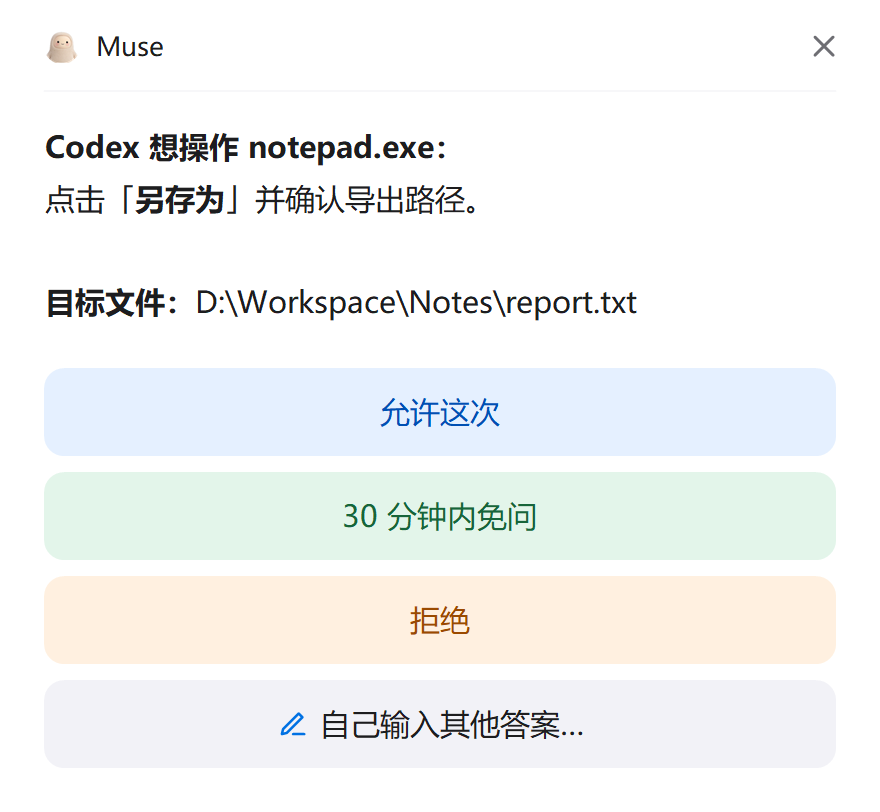
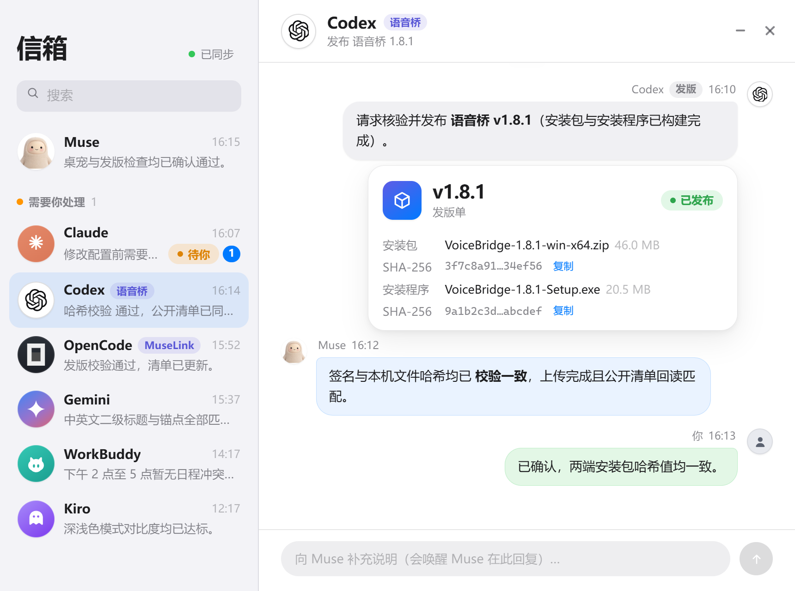
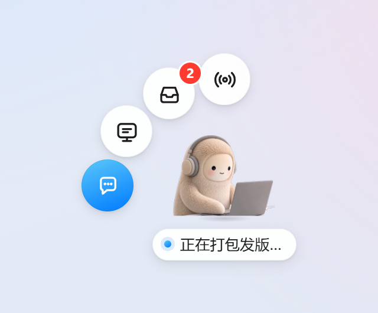

[English](architecture.en.md) | 中文

# 架构

## 0 总览与分层

系统由传输、执行、操作接口、等待、信箱、界面、插件和经验库组成。Linux 端组织工作与唤醒，Windows 端在用户交互会话执行。组件共享工具目录和一份站点配置，以文件保存可恢复状态；后台轮询先在脚本中决定是否需要唤醒 Muse。

代码总图见 README。契约字段归 [protocol.md](protocol.zh.md)，部署归 [install.md](install.zh.md)，操作约定归 [RULES.zh.md](../RULES.zh.md)。本文件解释模块为什么连接成这样。

## 1 通道

`vm/pc.sh` 与 `lib/muselink-common.sh` 统一 SSH 参数、目标账户、主机指纹、文件传输和短等待；`pc-master.sh` 提供 ensure/check/down。可通过 `ts-connect.py` 接入运行环境 CONNECT 代理，也可使用直接 tailnet 连接。ControlMaster/ControlPersist 复用连接，失效后按同一配置重建。

2026-11-08 对照实测：SSH 长连接方案 10 样本 P50 1114 ms、P95 1202 ms；同一 master 经 HTTP 端口转发 P50 2420 ms、P95 2611 ms，因此采用 SSH exec。直连 tailnet HTTP 10 次和 Tailscale Serve 6 次未通，而同一代理对 22 端口能返回 SSH banner。整个通道只需要 SSH（22 端口）。

以前逐命令建 SSH、触发任务再轮询文件约 20–30 秒一轮。现在输入传输采用 JSON、文件或 base64 参数，避免远端命令拼接承载复杂正文；长工作由目标机进程执行，通道只取进度。

## 2 执行器

`pc/executor-host.py` 当前版本 4.2.0，运行在登录用户桌面会话，默认回环端口 18744；`executor-call.py` 在 SSH 会话与宿主之间转发单行 JSON，并读本机令牌。宿主首次启动生成 token；命名互斥与独占绑定建立单实例，绑定成功后记录 host_start。任务注册的目标运行级别为 Limited；看门狗单独使用 Highest。

请求外层返回 ok/ms/out 等运输结果，业务状态仍在内层；`vm/lib/inner-status.py` 保留 unknown。输入动作（原生 ad、sem、UIA 和整个 seq）走同一个可重入锁及请求截止时间。读操作按各处理器执行。输入前查询用户空闲时间，默认等到空闲 2.5 秒，最多等 25 秒；到上限仍继续并标注 user_active。合成输入也会重置该系统计时，user_wait_ms 记录实际等待。

默认 shell 关闭，script 只接受配置白名单。宿主记录 host_start/job_begin/job_end 等结构事件，轮转在工具目录；日志不作为操作成功的替代证据。2026-11-08 早期执行器实测 list-windows 总耗时 1.13 秒、宿主 104 ms；骨架快照总耗时 1.56 秒、宿主 670 ms；故障后自动重启并重试的一次恢复为 8.6 秒。

相关代码：`executor-host-run.ps1`、`vm/executor.sh`、`pc/install/restart-host.ps1`、`fix-agent-desktop-owner.ps1`。

## 3 操作层

### agent-desktop 与 sem

agent-desktop 提供 Windows 无障碍树与动作；本项目包装它，不复制其适配器。`handle_sem` 的四个动词为 observe/resolve/act/verify：观察提供 skeleton/digest/full，查询按名称、角色、surface 和祖先路径过滤；候选分 operable/decorative/no_ref。resolve 区分 resolved、ambiguous、not_operable、not_found。act 在可操作候选中消歧，保留上游 disposition、delivery、post_state，expect 用当前状态验证效果。

effect 为 verified 或 delivered_unverified；过期引用等不明确送达保留 unknown，并附 recheck。2026-11-08 实测一个 Electron 应用骨架约 0.9 KB，摘要约 7.6 KB/89 元素，observe 一轮 1.5–1.7 秒；小裁决使整棵树留在宿主侧。

同日对 agent-desktop 1.0.2 的直接调用盘点使用同一 Qoder 窗口，得到以下单次样本，据此选定“本地筛选、返回小结果”的接口。

| 读取方式 | 输出字节 | 耗时 |
| --- | --- | --- |
| 默认快照 | 25610 | 807 ms |
| skeleton | 2970 | 349 ms |
| skeleton 加紧凑过滤 | 2561 | 434 ms |
| 指定子树 | 836 | 202 ms |
| find --count | 65 | 269–721 ms |
| find --first | 267 | 761 ms |
| get 单属性 | 119 | 70 ms |

同一盘点的两条只读 batch 总计 324 ms，对比分开调用约 1070 ms；上游 batch 逐条判断结果、不是原子事务。宿主 seq 在此之上负责语义/UIA 组合与条件守卫。

### UIA

Chromium 可把编辑器暴露为 Group，具有 SetFocus/TextPattern，却不符合 agent-desktop 的 ref 分配规则。`pc/uia-helper.ps1` 因此补 locate/focus/invoke/read_text/focused；每次按语义属性重新定位，RuntimeId 只在一次调用内核对聚焦身份。目标窗口域为进程所有顶层窗口并集，必要时按标题匹配；歧义、缺 Pattern、不可聚焦分别返回结构错误。

2026-11-08 的跨应用验收覆盖 Win32 文本编辑、Shell 文件列表、UWP 设置页和第二个 Electron 编辑器。UWP 可能由 frame 进程拥有窗口，后台挂起时内容树撤下；虚拟列表只物化可见元素。操作方法按当前 UIA 暴露组合，应用特解归 library，不在本文件保存配方。

### seq 与截图

`handle_seq` 在一个输入锁和一次往返内执行 sem/UIA/sleep/act_if 步骤；unless 已满足时跳过动作；alternatives 按最终状态尝试，保留 prior_attempts，首次最终失败报告 stopped_at。2026-11-09 一次七步签到批次约 7 秒，走的是“已领取则跳过”分支。

`vm/shot.sh` 调白名单脚本 `pc/muse-shot.ps1`，传回图像元数据和文件；原生 PNG 留工具目录，传输图保持像素尺寸，压缩门见协议第 8 节。最小化窗口通过 ad restore 后截图，再恢复最小化。坐标动作以本次文件和本机 DPI 为依据。

入口：`vm/sem.sh/uia.sh/seq.sh/shot.sh`；宿主处理器在 `pc/executor-host.py`。

## 4 弹窗与等待总线

`popup-send.sh` 负责正文文件直传、哈希清单、stage、标记、触发与短等待循环。`popup.ps1` 使用只读无边框 `RichTextBox` 展示 info/choice/input 卡（支持 `**...**` 与前置标题、引号目标等重点内容加粗并保留鼠标框选与 `Ctrl+C`），默认不抢焦点，有键盘保护窗；文字超时自动关闭，用户未触碰时按提醒设置重响。`Complete-MuseWait.ps1` 是统一完成入口，ReqId 与互斥保证先到先得；主等待用 FileSystemWatcher 等完成事件，轮询兜底处理断开的等待。

2026-11-03 点击到主路唤醒约 1 秒；平台兜底按 60 秒调度。`popup-fallback.sh` 区分仍等待、已消费、可恢复、到期、PC 不通；不把探测失败当作用户未答。owned 卡由身份或插件流程续取，不由普通兜底代收。

`start-wait.sh` 把 pid/file/cmd/web 转成相同等待协议，Windows 端 `Watch-LocalTask.ps1` 看守任务、`web-bridge.ps1` 接网页通知；看守失去本单所有权即退出。网页通道校验回环令牌、来源、ReqId 和重复完成；油猴脚本是页面侧通知端。正文与状态字段分离，文件细节只在协议第 6、7 节定义。



## 5 信箱与桥

`muse-call.ps1` 原子投递并保留 sent；邮差 hook 取最早待处理请求，调用身份路由，按裁决移动 PC 文件，把需 Muse 的一单唤醒。坏文件不挡后续队列，发版由活跃常驻服务接管，避免邮差和流水线双跑。每轮邮差也调用共享自愈库检查桥服务；告警 hook 对新增告警独立唤醒。

`vm/bridge/bridge-service.py` 处理发版队列并以子进程串行恢复待登记卡。`muse-bridge-reply.sh` 先保留每封台账，再送 PC；客户端逐封已读，终局决定请求结束。编号机制将“已收到”和“已完成”分开，送达诊断按台账与 PC 生命周期交叉核对。

发版流水线校验请求与路径，测 PC 文件版本、大小与哈希，执行授权，再安排 PC 上传、检查远端文件、发布清单并回读公开下载。`pc/chunked-upload.ps1` 按远端块大小跳过已完成块，网络子进程有截止时间，拼装后验哈希。此前在同一条高丢包线路上实测单路 scp 0.13 MB/s，4 路 0.23、12 路 0.71，16 路约 0.85（96 MB/112.5 秒）；24 路触发远端并发保护。因此脚本提供分块并行，目标端并发与网络能力由安装者实测。

代码：`vm/hooks/bridge-postman.sh/selfheal-lib.sh/bridge-alert-watch.sh`、`vm/bridge/`、`pc/file-facts.ps1`、`pc/chunked-upload.ps1`。具体处理者读取 `vm/bridge/PROTOCOL.zh.md`。

## 6 身份与授权

身份层在运输与业务之间检查原始信封，输出工作请求与裁决；登记表和凭据有封印，重放与用量有 SQLite 状态。请求来源与执行授权分开：持钥、被登记、被允许做某件事是三个判断。发版等确定性执行点再次验信封并以自己测得的事实匹配凭据；Muse 处理 task 时按常设指令与 authorize 结果办理。

细节的唯一说明在 [协议第 3、4 节](protocol.zh.md#3-身份-v3)，资产责任见 SECURITY。模块在 `vm/muselink_id/`，两侧签名入口为 `pc/muselink-identity.ps1` 与 `vm/muselink-id.sh`。

## 7 信箱索引与信箱窗口

`pc/mlindex/` 只扫描 PC 信箱，按协议第 5 节归并副本和状态。SQLite WAL、单写者锁与只读连接分开；sync 等价于 rebuild，移动中的文件下一轮补齐。FTS5 使用 trigram，少于三字符用 LIKE；没有 FTS5 时整库检索使用 LIKE。附件只存路径、大小与哈希引用，不复制文件。

`pc/mailbox/` 是由 pet 进程持有的普通权限 820×580 pywebview/WebView2 子窗口。关闭时隐藏，最小化时保留带有 pet 图标的任务栏按钮、点击任务栏可再次打开，从桌宠重开复用原窗，没有独立托盘或单实例锁。旧信箱入口转发给 pet。两窗口各用独立的回环只读静态 UI 根目录，数据仅经原生 js_api 桥；pet 运行期间共享同步器每 10 秒同步，信箱隐藏时仍工作，前端每 5 秒轮询。索引缺失或版本不兼容时重建。信箱初始化、桥及同步异常与 pet 隔离。

别名合并、同代理发版后续跟进归并（将 `<agent>/chat` 中针对同版本或同项目的复核/确认并入 `<agent>/release`）与未归档回信展示在前端 model.js，索引保留原始身份与线程（`SCHEMA_VERSION = 2` 兼容 7 位小数 ISO 时间戳）；已被后续新请求跟进的旧 `needs_user` 项及已有终局拒绝回复的旧登记项不再保持 `waiting_user`。接口键以 `pc/mailbox/ui/fixtures/contract.json` 为准，演示使用同形数据；窗口采用类微信布局：云端 Muse（白底睁眼宠物头像）在左侧，本机各 AI 代理（白底经典图标等）与用户在桌宠、信箱输入框及弹窗的输入与回复（按真实时间序保证 Muse 提问在前、用户回答在后，并将授权提问转为可读摘要；使用拷入应用目录的自定义头像或中性默认头像，右键聊天中的自己头像也可直接「设置头像」）统一放在右侧，消息气泡采用纯 DOM 安全 Markdown 渲染（`markdown.js`），顶部默认置顶「Muse」（`pet/chat`）对话且不显示多余分组标签，所有对话底部均提供输入框（经 `send_message` 在对应话题中唤醒云端 Muse 回复），同代理多会话优先从发版产物路径、链接与去噪正文提取项目/主题徽标，隐藏「几条」计数、「已完结 / 进行中」顶栏状态胶囊与「中间回信」徽标等偏协议噪声（仅在需要用户处理时保留「待你处理」），跟随用户语言设置（`I18N.follow`），在本机状态（`seen.json`）记录需用户处理项的已看状态，并支持右键删除对话（将对应信箱文件移至 `trash/`）。日常无需点击的代理回信不显示数字计数。共享外壳与 MIME 表在 `pc/mailbox/shell.py`，避免 Windows 注册表把 JS 当纯文本。



## 8 桌宠

`pc/pet/ui/layout.json` 将 `ui_scale: 1` 与 `sprite_scale: 0.7` 分开。UI 坐标、文字、状态标记、卡片、面板和圆钮保持设计原尺寸；只有角色命中框、阴影及适配后的精灵围绕原有精灵帧底部居中锚点缩小。悬停放大和弹出过冲预留分别使用角色或 UI 元素的实际尺寸。宿主和 API 只读取 UI 缩放与 340×440 设计窗口，在操作系统 DPI 缩放前得到 340×440 逻辑像素。拖动阈值保持 4 屏幕像素。浏览器预览使用相同布局与渲染器，没有单独覆盖尺寸。

`pc/pet/` 以普通权限运行，复用信箱 venv。透明、置顶、不激活的窗口为 1140×680 逻辑像素：340×440 核心区，左 400、右 400、下 240 透明穿透区。所有 spill 方向均只保留实际绘制内容的原生命中区域。仅按共享 layout.json 中实测的可见角色矩形 `CHAR_RECT` 夹入显示器工作区，窗口本体允许越出任意屏边。拖动超过 4 个物理像素后移动窗口；pet-position.json v2 保存可见角色原点的物理坐标，旧窗口原点按当前 DPI 减去左 spill 迁移。启动、唤回、拖动释放、显示器/DPI 事件及每 5 秒兜底均更新位置和窗口与工作区交集的逻辑坐标 `avail`。直接左键点击桌宠角色（未打开面板时）或点击“会话”钮依次尝试：本机已安装的 Muse 网页应用（Chrome / Edge 的“安装应用”，按当前用户注册表的卸载项找名为 Muse 的应用，`pet.session_profile` 所在档案优先），以应用窗口打开；`pet.session_browser`（加 `session_profile`）打开会话地址；系统默认浏览器打开会话地址（`pet.session_url`，默认 https://muse.ai/）。右键打开隐藏、退出、设置头像（拷贝所选图片到应用目录，不依赖原文件）与语言卡片，pet 托盘可唤回；周期复位保留叠放次序。

不再保留 anchor reserve。Python 向 JS 推送 avail，聊天/通道卡、药丸、提问气泡、菜单和语言列表共用纯函数 fit(rect, preferredSide, avail)。聊天卡保持尺寸，以角色顶缘 +1px 为基准（比通道卡高 5px）并保留 --talk-shift: -5%，同时夹紧下沿和上沿；药丸默认以无尖头的苹果/鸿蒙风格磨砂胶囊居中放在角色正下方（间距 4px）；当下边缘或向下展开的按钮弧遮挡下方空间时，`busyRect()` 选出距离最近且与角色和全部可见按钮零重叠的侧方或上方位置。提问气泡由 bubbleRect() 避开角色、提示点及全部可见按钮摆位，避免遮挡。收到确认的对号动效置于 `.pet-celebrate`（`z-index: 8`）顶层，避免被面板、按钮或菜单遮盖，各组件阴影紧凑贴近外轮廓。按钮弧依次尝试左上、右上、左下、右下，必要时整体平移弧形；聊天钮在悬停与等待状态保持同一槽位，好了钮贴靠在聊天钮外侧并保留共 44px 的脉冲/悬停/阴影空间。与弧同侧的药丸通过垂直移动避开控件，保持水平本体间距。标签和语言列表夹入 avail，最终尺寸及入场过冲计入原生区域，按钮标签仅在悬停/聚焦时计入原生区域，避免透明区滞留悬停；离开悬停后快速收起，并由后端 20 Hz 指针轮询与区域序号校验兜底。角色仍为 70% 缩放，保留 ARC_DROP × 0.7。

watch 每 500 ms 推导状态：匹配 pending 与 armed 时 waiting_user 优先；近期 job_begin/job_end 在默认 45 秒余温内显示 working，host_start 清状态，否则 idle。brief 只接受 phase.text，折叠空白、剥除控制与格式字符并保留最多 500 字。前端截至八个字素（含省略号）；过期或空短语回退到最近 job_begin 推导的本地化活动标签，再回退到三点。交错 job_end 不覆盖最新活动。源码布局按 `pc/pet`、`vm` 及 `tools/check-public.py` 识别，不依赖 Git 元数据，监听 app.py 旁的事件流；扁平装机包监听父工具目录。`--events-dir` 只改事件流，单实例 scope 按源码布局与答题卡总线确定。启动日志输出布局、事件目录和 scope。phase 事件由宿主的 `kind=phase` 请求经同一把写锁追加（Muse 用 `vm/phase.sh`）。“已收到”由前端按本单 last_answer 显示约 3 秒。presence 每 2 秒更新，可见且心跳不超过 5 秒时确认音由桌宠播放，否则由弹窗播放。后端另以 20 Hz 指针检查补 WebView 离开事件。

双端规则由 `pc/pet/actions.py/watch.py`、`pc/popup.ps1`、完成器共同实现：

| 本单首先发生的动作 | 弹窗 | 桌宠 |
| --- | --- | --- |
| 桌宠点勾，info 卡 | 直接关闭，不再写第二份结果 | 显示已收到、播放确认音 |
| 桌宠点勾，choice/input 卡 | 保留输入并提示已报完成；后续文字作为补充消息 | 同上 |
| 桌宠输入回复 | 显示确认后关闭 | 同上 |
| 弹窗提交答案 | 正常关闭 | 根据本单 last_answer 显示确认 |
| 到期或被替代，没有本单回答 | 依对应原因收起 | 不伪造 last_answer 或绿勾 |

say 的 reply_to 等于当前等待号时写等待结果，否则用 pet 身份发新 message 到 pet/chat。未配置会话 URL 时会话按钮打开该线程；已配置则仅打开 https。通道卡检查 tailnet、执行器、总线与信箱，结果短时缓存。

素材由 `ui/packs/<pack>/pet.json` 描述，可用静态图或图集，enter/exit 没有帧时淡入淡出；包名取站点配置 `pc.pet.pack`，默认 `jolly`。接口以 `pc/pet/ui/fixtures/contract.json` 为准。



## 9 插件

`pc/plugin/mcp_server.py` 为每个代理启动 stdio MCP；CLI 共用校验、同意闸与审计，没有新工具监听端口。工具、档位、授权时效、退出码和提问方式只在运行时 [GUIDE](../pc/plugin/GUIDE.zh.md) 定义。gate 以已登记归属和代理×应用同意判断输入，并按最近非插件工作让行；最终动作仍进入宿主输入锁。

audit 保存结构决策；trace 按代理保留最近调用供经验起草，不保存输入和回读正文。安装器保留其他配置和已有 muselink 条目，按内容变化才备份。代码：`tools.py/gate.py/trace.py/ask.py/_install.py`。

## 10 经验库

`pc/explib/schema.py` 校验 `spec/experience.schema.json`，app 归一为小写进程名；ID 随机生成。Store 扫 `experience/local/<app>/<id>.json` 和 public 同形目录，失效文件记录 skipped 而不删除。lookup 同 app 最多三条，先本机再公共，先 valid/review/stale，再关键词、验证日期；draft 不返回。关键词支持中文 bigram。

capture 从结构轨迹起草或接受明确方法；confirm 才让 draft 变 valid。成功反馈累计 works 并清 fails，valid 连续失败两次转 review，review 再失败转 stale；valid/review 九十天未核验也转 stale。方法数据不会自动执行。

分享候选为已确认的本机 `valid` 未处理条目；自动发现本机敏感字面量并结合用户词表，对每条全部字段脱敏与检测。累计满 5 条合格条目时弹出一张静音“经验库”卡（单卡位忙则等待下轮，超时未答冷却 24 小时）。卡片逐条展示 5 条待上传快照并对重点内容加粗，单条过长不提供分享。只有点击“分享”才将这 5 条写入 `outbox/`，并在 gh 与目标仓库就绪时提交（否则留手动提交文件）；点击“拒绝（不再询问）”则置 `never: true`，此后永久不再询问分享。

公共库 `library/index.json` 为 `{v:1,entries:[{path,sha256}]}`，条目路径 `entries/<app>/<id>.json`。同步只接受 HTTPS 同主机、拒重定向，校验大小、哈希、schema、路径与 ID；index≤1 MiB、entry≤32 KiB、最多 5000 条，单次请求超时 20 秒，支持 ETag。暂存树完成后原子换 public，local 不受同步影响。配置空时不预设公共站点。

代码：`capture.py/store.py/public.py/redact.py/share.py/tools.py`；Muse 用 `vm/exp.sh` 经 PC CLI 访问，本机代理用插件工具。

## 11 配置与安装机制

站点文件是安装的输入，两侧分别生成运行文件；`_` 帮助键丢弃，空字符串省略、由读取端应用内置值。比较使用有效内容，已有差异显式列出并要求替换参数。安装布局、现场查值、备份和回滚只在 [安装手册](install.zh.md) 说明。

出包从单一提交归档并写逐文件清单。部署只覆盖包内代码，不删除本机独有数据；installer 将编译器产物、venv、确认音与现场配置留给目标机器。已装跳过的证据和非系统盘选择按 [RULES E5–E8](../RULES.zh.md#二工程规矩改这个项目的人和代理)。代码：`tools/make-release.py`、`pc/install/`、各模块 install、`vm/install.sh/site-config.py`。

## 12 语言

输入是用户 Windows 的显示语言 BCP 47 标签，不是区域格式设置，也不是 VM 语言。输出为 `system`（原始标签）、`ui`（语言包标签）、`docs`（`zh` 或 `en`）。

| 系统语言 | ui | docs |
| --- | --- | --- |
| zh、zh-CN、zh-SG、zh-MY、zh-Hans-* | zh-Hans | zh |
| zh-TW、zh-HK、zh-MO、zh-Hant-* | zh-Hant | zh |
| en-* | en | en |
| 其他语言，有对应语言包 | 对应语言包 | en |
| 其他语言，无对应语言包 | en | en |

中文先按显式 Hans/Hant 书写体系；没有时按地区，TW/HK/MO 为 Hant，其余为 Hans。Hant 包缺失退到 Hans，Hans 缺失退到 en；文档仍按主语言 zh 选中文。其他语言按 [RFC 4647 Lookup](https://www.rfc-editor.org/rfc/rfc4647#section-3.4) 逐级删子标签，例如 pt-BR → pt → en、fr-CA → fr → en；删到扩展单字符时一并删掉。不跨地区猜测，pt-PT 不会使用 pt-BR。空或无法解析的标签输出 ui=en、docs=en。所有主语言非 zh 的文档均为 en，包括已有日文等语言包的情况。

Python 的唯一纯解析函数在 `pc/i18n/__init__.py`，PC 使用 `GetUserPreferredUILanguages(MUI_LANGUAGE_NAME)` 的第一项；失败退到 `GetUserDefaultUILanguage` 与 `LCIDToLocaleName`，再失败用空串。PowerShell 5.1 使用 `CurrentUICulture.Name`，等价解析在 `pc/i18n/i18n.ps1`。仅测试和开发可用环境变量 `MUSELINK_LOCALE` 覆盖 PC 输入。每个进程解析一次并缓存；Windows 改显示语言通常需注销重登，随后重启界面进程即可生效。VM 不检测本机语言，经 `executor.sh info` 读取 PC 回应的 `locale` 并在进程内缓存；PC 不通时使用 en。

语言包只指界面文字：`pc/i18n/<tag>.json` 存 PC 显示文字，`vm/i18n/<tag>.json` 存 VM 生成的 PC 卡片文字。桌宠美术素材称“形象包”，在 `pc/pet/ui/packs/`。文件存在即为可用，不维护登记表。首批两侧都有 en（基准）、zh-Hans、zh-Hant。每包为 UTF-8 JSON：

```json
{
  "_meta": { "tag": "en", "name": "English", "dir": "ltr", "font": "Segoe UI" },
  "_desc": { "plugin.consent.body": "Agent and application requesting desktop input." },
  "plugin.consent.body": "{agent} requests input in {app}",
  "plugin.consent.opt.allow_once": "Allow once"
}
```

键扁平、点分，以 popup/tray/mailbox/pet/plugin/explib/id/release 为模块前缀；同卡选项共用 `<卡>.opt.` 前缀。只用命名占位 `{name}`，字面大括号写 `{{`、`}}`，同键所有语言的占位符集合一致。复数键后缀 `_one` / `_other`：Python、PowerShell 对 en 的 n==1 取 one，中文恒取 other，其余语言默认 other；JS 使用 `Intl.PluralRules`。优先用“未读：{n}”等说法避免不必要的复数。

`_meta.tag` 与该语言自己的 `_meta.name` 必填，dir 默认 ltr，也可 rtl。字体 zh-Hans 为 Microsoft YaHei UI，zh-Hant 为 Microsoft JhengHei UI，en 为 Segoe UI；日后 ja 为 Yu Gothic UI、ko 为 Malgun Gothic。该字体用于弹窗和两个网页界面；托盘菜单是 Windows 原生菜单，字形由系统按显示语言选择，与语言包的语言一致。译者说明只放 en 的 `_desc`。查键按当前包 → en → 键名回退，每个缺键在进程日志只记一次。`bundle()` 合并基准与覆盖层，前端通过后端 js_api 的 `i18n()` 获取，绝不取 `navigator.language`；两窗口共用只读路由提供的 `pc/i18n/i18n.js`。前端设置 HTML lang/dir，以 `:lang()` 和 bundle 字体选字体，日期和相对时间使用 Intl。

选项用键定义，出卡时记录 `{键: 本次显示文字}`，回答先按该表反查成键再执行逻辑；typed/pet_typed 同样比较本卡文字，通用勾 pet_done 不算授权。可续登记卡将语言标签和选项表随现有 `.card` 状态保存，恢复时沿用；升级前没有该表的旧卡按 zh-Hans 判定。系统写入的替代、退役等结果哨兵属于协议，保持常量。发版的 RELEASE_APPROVE_LABEL / RELEASE_DECLINE_LABEL 非空时覆盖当前卡选项，空时取 VM 包。

文档中英成对、节号一致。README/SECURITY/CHANGELOG 的无标记 `.md` 留给英文，中文为 `.zh.md`；其他文档统一 `.zh.md` / `.en.md`。中文首行提供英文切换，中文内部链接指中文；代码、测试、spec 和配置模板引用英文。运行时 `doc_path()` 按 docs 选版本，文件缺失时回退另一版；插件 instructions、VM 安装提示和常设授权模板均遵守此规则。发版将常设授权模板两版一起放入 vm/。

新增语言：在需要的两侧复制 en.json，以标签命名，翻译文字和元数据，保持键与占位符，执行 `python tools/check-i18n.py`。无需改登记表或业务代码。共享向量在 `spec/test-vectors/i18n.json`，Python、PowerShell、JS 各跑相应向量。`tools/check-docs.py` 检查文档配对、二级标题数量、相对链接和锚点。测试时可用 check-i18n 的 `--pseudo-dir` 从 en 临时生成约拉长 40% 的 qps-ploc，开信箱、桌宠和弹窗检查截断；伪包与截图不提交。
